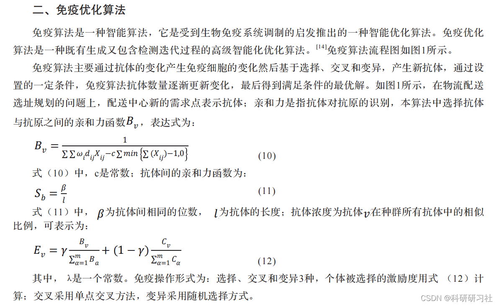
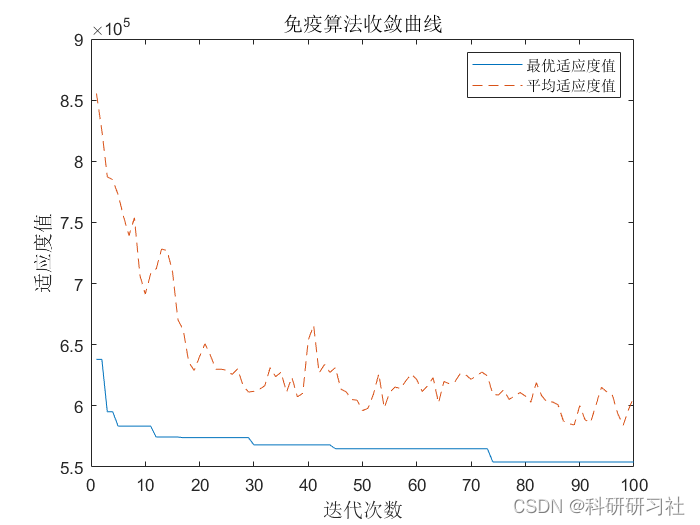
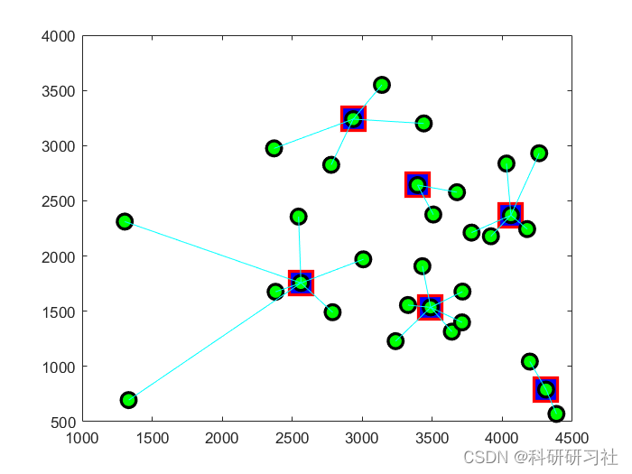

# Application of Immune Optimization Algorithm in Logistics Center Site Selection (Matlab Code Implementation)

​  
Contents
1. Overview
2. Introduction to Immunological Algorithms
3 Principle Analysis
4 Running results
5 Results Analysis
6. MATLAB code implementation
7 References
8. Conclusion
1. Overview
With the rapid development of the economy, e-commerce platforms have flourished, leading to an increasing number of consumers opting for online shopping. This trend has swiftly spurred new developments in the logistics industry. The logistics sector plays a crucial role in China's economic growth, and its expansion enhances regional employment capabilities. Optimizing regional industrial structures can reduce the costs of the logistics industry. Modern logistics is now an essential component of modern service industries. One of the main research directions in the academic study of the logistics industry is how to integrate potential issues within the transportation chain.According to the development trend of the logistics industry, Distribution center is the link between distributors and A critical link between retailers and customers. Considering all factors comprehensively and making reasonable planning of the distribution center location is particularly important. The location planning of logistics distribution center has been widely concerned in the academic field. Logistics is the process of transporting goods from warehouses to destinations. Including various basic functions such as loading and unloading, Handling, Transportation Distribution, Processing, etc.The process of transporting goods from the place of production to the place of demand. A central site is required for the centralized distribution of goods. The purpose of establishing a central site is to ensure the efficient and expeditious delivery of goods to their destination. This central site is the logistics distribution center. Logistics distribution center site selection is influenced by the distribution of materials. Due to factors such as transportation and other circumstances. Considering various factors, the rational planning of the specific location of distribution centers plays a crucial role in the development of the logistics industry. The focus of this paper is to construct a mathematical model. Utilize intelligent software to scientifically plan the location of logistics distribution centers. 2. Introduction to Immunological Algorithms
The immune algorithm is an intelligent optimization algorithm inspired by the biological immune system. The immune optimization algorithm is a high-level intelligent optimization algorithm that includes both generation and detection iteration processes. 3 Principle Analysis
4. Running Results Editing
Editor
5 Results Analysis: When the number of iterations in the immune algorithm is set to 100, taking into account delivery time and the comprehensive weight determined by delivery time and demand, different delivery points are set according to different demands. The immune algorithm has a rapid convergence effect. Therefore, when solving the logistics distribution planning problem, the immune optimization algorithm is a reasonable planning choice.
6. MATLAB code implementation
Application of immune optimization algorithm in the location selection of logistics distribution center (Matlab code implementation)
%% Application of Immune Optimization Algorithm in the Location of Logistics and Distribution Centers\n%% Clear environment\nclc\nclear\n\n%% Basic algorithm parameters\nsizepop=50;           % Population size\noverbest=10;          % Memory library capacity\nMAXGEN=100;            % Iteration count\npcross=0.5;           % Cross-over probability\npmutation=0.4;        % Variation probability\nps=0.95;              % Diversity Evaluation Parameters\nlength=6;             % Number of distribution centers\nM=sizepop+overbest;\n\n%% step1 Identify antigens, define the population information as a structured data type.\nindividuals = struct('fitness',zeros(1,M), 'concentration',zeros(1,M),'excellence',zeros(1,M),'chrom',[]);\n%% step2 Generate initial antibody population\nindividuals.chrom = popinit(M,length);\ntrace=[]; %Record the individual fitness and average fitness of each generation\n\n%% Iterative Optimization\nfor iii=1:MAXGEN\n\n     %% step3 antibody diversity evaluation\n     for i=1:M\n         individuals.fitness(i) = fitness(individuals.chrom(i,:));      % Calculation of antibody-antigen affinity (fitness value)\n         individuals.concentration(i) = concentration(i,M,individuals); % Antibody Concentration Calculation\n     end\n     % Synthetic affinity and concentration evaluation antibody excellent degree, get reproduction probability\n     individuals.excellence = excellence(individuals,M,ps);\n          \n     % Record the best individual and average fitness of the population in contemporary times.\n     [best,index] = min(individuals.fitness);   % Find the optimal fitness\n     bestchrom = individuals.chrom(index,:);    % Find the optimal individual\n     average = mean(individuals.fitness);       % Calculate the average fitness\n     trace = [trace;best,average];              % Record\n     \n     %% step4 Form a parental group based on excellence, update memory library (add elite retention strategy, controlled by s)\n     bestindividuals = bestselect(individuals,M,overbest);   % Update memory library\n     individuals = bestselect(individuals,M,sizepop);        % Form parental group\n\n     %% step5 Selection, crossover, mutation operations, then add the antibodies into the memory library to generate a new population.\n     individuals = Select(individuals,sizepop);                                                             % Selection\n     individuals.chrom = Cross(pcross,individuals.chrom,sizepop,length);                                    % Cross\n     individuals.chrom = Mutation(pmutation,individuals.chrom,sizepop,length);   % Variation\n     individuals = incorporate(individuals,sizepop,bestindividuals,overbest);                               % Add the antibody to the memory library.\n\nend\n\n%% Draw the convergence curve of immune algorithm\nfigure(1)\nplot(trace(:,1));\nhold on\nplot(trace(:,2),'--');\nlegend('Optimal fitness value','Average fitness value')\ntitle('Immune Algorithm convergence curve','fontsize',12)\nxlabel('Iteration count','fontsize',12)\nylabel('Fitness value','fontsize',12)\n  
7. References
[1] Wan Xiao, Qiao Yuyang. Research on the Development Dilemma and Strategies of Logistics Industry [J]. E-commerce, 2019, (12): 1-2.
[2] Zhu Lini. Vigorously Promoting the Development of Modern Logistics Industry to Promote Regional Economic Development [J]. Modern Business, 2019, (31): 40-41.

## Images

<!-- PAYMENT_BLOCK -->

## Get this dataset

- Payment link (Stripe): [Buy now](https://buy.stripe.com/3cs8yP7sY87d0vu9AB)
- Payment QR code: 

<!-- /PAYMENT_BLOCK -->
